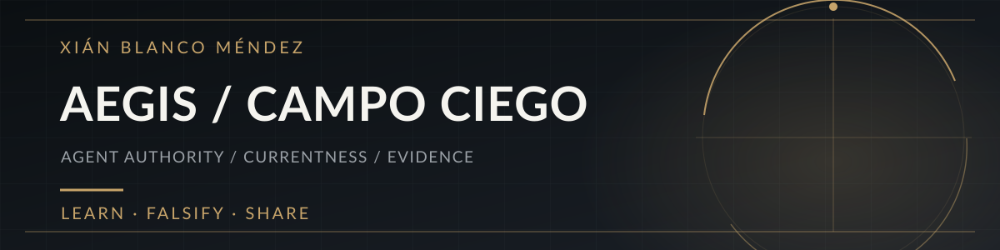

# Xián Blanco Méndez

**Independent research & systems development · AEGIS**

I study the gap between what an AI agent was allowed to do, what actually happened when it acted, and what the available evidence can prove.

### Questions I work on

- **Authority:** was the action still authorized when the effect occurred?
- **Unknown outcomes:** what if a tool succeeds but its response disappears?
- **Currentness:** which state or record remains valid after corrections and conflicts?
- **Evidence:** did a test verify the intended behavior—or merely return PASS?

### Public work and technical contributions

**[Research Note 001 — When PASS Is Not Promotion](https://github.com/xianmgb-cmyk/research-note-001-input-binding)**  
A short research note and executable synthetic example about binding evaluation receipts to the exact input consumed. The example is bounded; it is not a production certification.

**[kiri-gate C01 — a concurrent UNKNOWN-outcome race](https://github.com/aryan597/kiri-gate/issues/1)**  
Reported and reproduced a stale-read/deduplication race using simulated effects. The maintainer [published a fix](https://github.com/aryan597/kiri-gate/commit/30aec88bc22cb42ac853dc8515d608d0a91bf872). A [follow-up observation](https://github.com/aryan597/kiri-gate/issues/1#issuecomment-6234837962) shows how the regression test can return a false PASS under a deliberately induced scheduler timeout. That follow-up is a test-quality finding, not evidence that the original fix fails in the controlled C01 run.

**[AgentIF — applicability coverage in evaluation](https://github.com/THU-KEG/AgentIF/issues/9)**  
An open question about reporting applicable versus total constraints alongside aggregate success metrics. This is not a confirmed defect report.

**[Currentness v0.2 — research artifact](https://doi.org/10.5281/zenodo.22940604)**  
An authored, bounded exploration of evidence and state validity. Subsequent self-review identified counterexamples beyond the original cases; correction and independent adjudication remain open.

### Building AEGIS

AEGIS is ongoing private research into durable, auditable agent systems. Its private code is not published here, and bounded self-review results should not be mistaken for independent, general validation.

### Working method

**Observe → reproduce → try to falsify → correct → preserve the evidence and its limits.**

I value concrete failure traces, independent counterexamples, and careful comparisons over claims of certainty.
